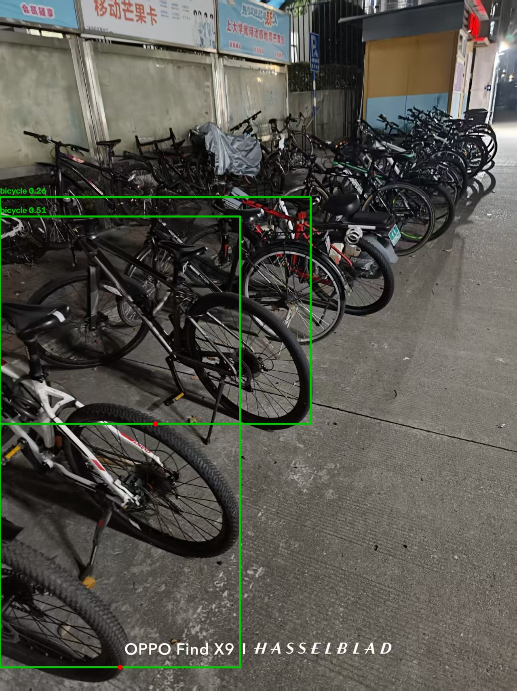
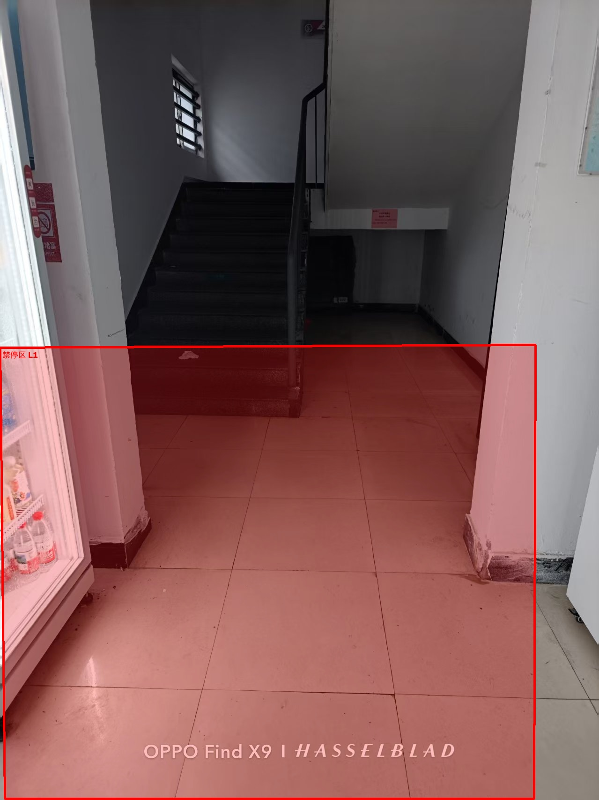

# 校园非机动车违停检测系统

> 基于 YOLO 的校园电动车 / 自行车违停检测：目标检测 → 多边形禁停区判定 → 停留时长 → 分级告警 → 可视化。
> 含网页端与桌面端，11 个迭代版本完整保留在 Git 历史与 Tag 中。



---

## 一、这个项目解决什么问题

校园里电动车、自行车常被停在消防通道、楼道口、人行道上。目前依赖人工巡查，
既费人力，也拿不出"这辆车停了多久"的证据。

本系统从一段视频或一张照片里：

1. 找出每一辆非机动车（检测）
2. 判断它落在哪个禁停区（多边形区域 + 脚点判定）
3. 统计它停了多久（跨帧跟踪 + 停留计时）
4. 按区域等级给出分级告警（消防通道 10s / 楼道口 60s / 普通通道 180s）
5. 保存带框截图与事件日志，可追溯

---

## 二、核心设计

| 设计 | 为什么这么做 |
|---|---|
| **用脚点（框底边中点）判定区域** | 摄像头斜视时框中心会偏移，轮胎着地点才代表"车停在哪" |
| **多边形区域而非矩形** | 楼道口、消防通道形状不规则，矩形会误框合法车位 |
| **三条件判定：连续帧 + 停留时长 + 冷却** | 路过的车不报警、停放的车才报警、同一位置不刷屏 |
| **区域滞回 + gap 容错** | 边界抖动不清零计时，短时遮挡不中断计时 |
| **骑手过滤** | 有人骑着的车不算违停 |
| **配置驱动区域（JSON）** | 换机位只改配置，不改代码 |

---

## 三、版本演进

仓库的每个版本都是一个 Git Tag，可直接 `git checkout v4` 查看当时的代码。

| Tag | 主题 | 关键进展 |
|---|---|---|
| [v1](../../releases/tag/v1) | 初版流程 | VOC→YOLO 转换、训练、推理跑通，mAP50 0.827 |
| [v2](../../releases/tag/v2) | 训练对比 | 五组模型对比实验，最优 yolo26n@640 mAP50 **0.880** |
| [v3](../../releases/tag/v3) | 参数调优 | iou/conf/TTA/切片推理对比，召回 0.926 → **0.941** |
| [v4](../../releases/tag/v4) | 多边形判定 | 引入不规则禁停区 + 脚点判定 |
| [v5](../../releases/tag/v5) | 多帧判定 | 跟踪 + 投票 + 停留 + 网格冷却 |
| [v6](../../releases/tag/v6) | 分级告警 | 多区域、等级、JSON 配置驱动 |
| [v7](../../releases/tag/v7) | 工程化 | `judge_core` 判定核心、事件级评测、单元测试 |
| [v8](../../releases/tag/v8) | 合并版 | 数据配对 864→**895 张**、网页演示、测试全绿 |
| [v9](../../releases/tag/v9) | 可信度 | 车辆类别白名单、测试入口补齐 |
| [v10](../../releases/tag/v10) | 部署加固 | 请求校验、推理锁、启动脚本回退 |
| [v11](../../releases/tag/v11) | 当前版本 | 修复双层前缀与掩码归一化，产出真实评测数据 |

详细说明见 [docs/版本演进.md](docs/版本演进.md)。

---

## 四、快速开始

### 4.1 环境

```bash
python -m pip install -r requirements.txt
```

- Python 3.10+（开发环境 3.14.4）
- ultralytics 8.4+
- 无需 CUDA，CPU 可运行

### 4.2 模型权重

权重不在仓库内（体积原因），可从 Releases 下载，或用自己的数据训练：

| 模型 | 用途 | 放置位置 |
|---|---|---|
| `ebike26.pt` | 检测（ebike / bicycle） | `models/ebike26.pt` |
| `zones.pt` | 区域分割（forbidden / passage / legal） | `models/zones.pt` |

### 4.3 网页端

```bash
python src/webapp.py --model models/ebike26.pt --zone-model models/zones.pt
```

浏览器打开 http://127.0.0.1:8000 ，拖入图片即可识别，
支持手画禁停区、导入/导出 `zones.json`、下载结果图与 JSON。

### 4.4 视频判定

```bash
python src/demo_v8.py --source video.mp4 --model models/ebike26.pt --zones src/zones.json --speed 10
```

输出：带框视频 + `events.csv`（时间 / 区域 / 等级 / 停留时长 / 证据截图）。

### 4.5 区域自动识别

```bash
python src/predict_zones.py --model models/zones.pt --source photo.jpg
```



---

## 五、评测结果

### 5.1 检测（2 类，100 epochs）

| 模型 | imgsz | mAP50 | mAP50-95 | P | R | 参数量 |
|---|---|---|---|---|---|---|
| yolo11n | 640 | 0.827 | 0.490 | 0.908 | 0.719 | 2.62 M |
| **yolo26n** | **640** | **0.880** | **0.523** | 0.884 | 0.850 | 2.57 M |
| yolo26n | 960 | 0.880 | 0.528 | 0.918 | 0.848 | 2.57 M |

结论：yolo26n@640 性价比最高；提高分辨率不提点反而更慢。

### 5.2 区域分割（32 张标注图，Mask mAP50 0.518）

多边形 IoU 评测（`eval_zones.py`）：

| 指标 | 数值 |
|---|---|
| 平均 IoU | 0.660 |
| IoU ≥ 0.5 命中 | 34 / 40 |
| 精确率 | 0.667 |
| 召回率 | 0.850 |
| F1 | 0.747 |

> 评测集包含训练图片，指标偏乐观；泛化性能需用新照片重测。

---

## 六、目录结构

```
src/
├── webapp.py            网页后端（单图识别）
├── web/index.html       网页前端
├── desktop.py           桌面应用（pywebview 原生窗口）
├── judge_core.py        判定核心：跟踪 / 滞后 / 计时 / 冷却 / 证据 / 推送
├── demo_v8.py           视频与单图判定主程序
├── predict_zones.py     区域自动识别（掩码 → 多边形）
├── eval_zones.py        区域定量评测（多边形 IoU）
├── eval_events.py       事件级评测（P/R/延迟/误报）
├── voc2yolo.py          VOC → YOLO 检测格式（含配对容错）
├── zones2yolo_seg.py    labelme → YOLO 分割格式
├── train_zones.py       区域模型训练
├── zones.json           三级禁停区配置
└── tests/               6 组自动化测试
```

---

## 七、测试

```bash
python src/tests/run_all.py
```

```
[PASS] judge_core 判定层自测
[PASS] demo_v8 端到端冒烟
[PASS] voc2yolo 配对逻辑
[PASS] webapp 后端单测
[PASS] eval_zones 几何评测
[PASS] predict_zones 掩码提取
全部通过
```

---

## 八、数据集说明

| 数据 | 说明 | 是否开源 |
|---|---|---|
| 检测数据集（895 张） | 公开电动车数据集整理，2 类 | 不随仓库分发，见文档 |
| 区域标注（32 张） | 自行采集的校园照片 + labelme 多边形 | 不随仓库分发（含校园场景） |

标注规范见 [docs/数据标注规范.md](docs/数据标注规范.md)。

---

## 九、已知限制

| 编号 | 限制 |
|---|---|
| L1 | 检测数据来自公开街景数据，非本校场景，跨场景泛化有限 |
| L2 | 区域分割仅 32 张训练图，`legal` 类样本不足 |
| L3 | 单图判定只表示"位于禁停区内"，不代表停留时长达标（需视频） |
| L4 | 未做硬件部署（树莓派等）实测 |

---

## 十、License

代码采用 [MIT License](LICENSE)。
数据集与第三方权重遵循其原始许可，不包含在本仓库中。

---

## English Abstract

A YOLO-based system for detecting illegally parked e-bikes and bicycles on campus.
It combines object detection, polygon-based no-parking zone judgement using the
foot point of each vehicle, temporal filtering (consecutive frames + dwell time +
cooldown), and graded alerting. Ships with a web UI, a desktop shell, and 6 test
suites. Eleven iterations are preserved as git tags (v1–v11).
