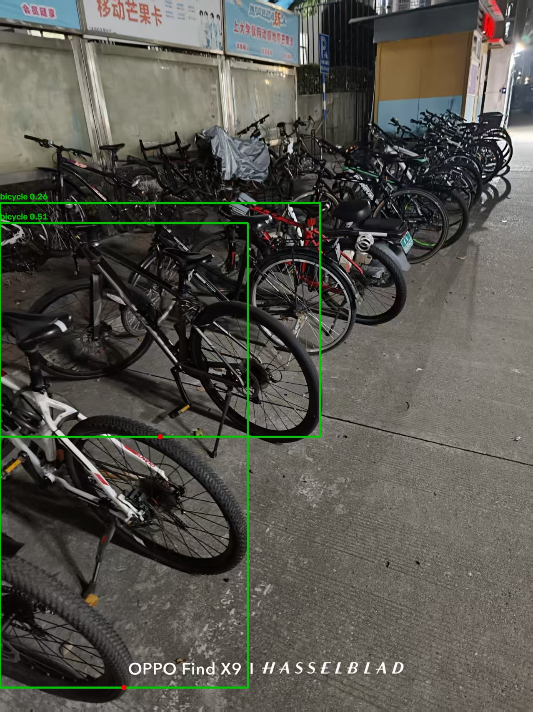
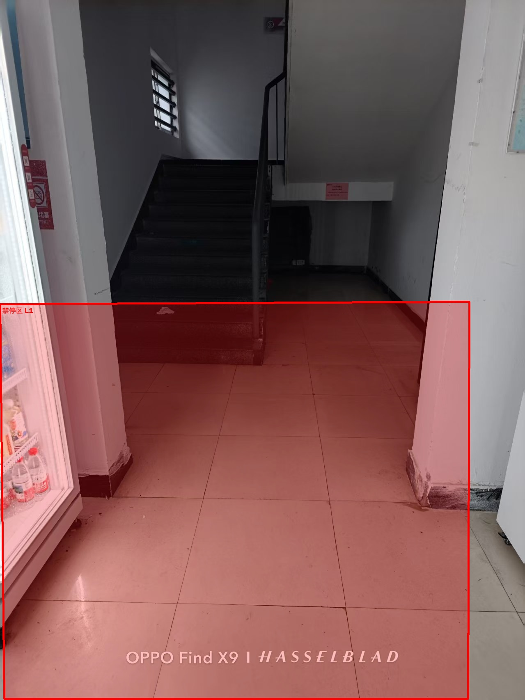

# Campus Illegal Parking Detection

<p align="center">
  <a href="https://github.com/rayqwen616-byte/campus-parking-detection/actions/workflows/tests.yml"></a>
  <a href="LICENSE"></a>
  
  
  
</p>


> YOLO-based detection of illegally parked e-bikes and bicycles on campus:
> object detection → polygon no-parking zone judgement → dwell time → graded alerts.
> Comes with a web UI, a desktop shell, and 11 iterations preserved as git tags.



---

## 1. Problem

E-bikes and bicycles are routinely parked in stairwell exits, fire lanes and
pedestrian walkways on campus. Enforcement relies on manual patrol, which is
labour-intensive and produces no evidence of *how long* a vehicle has been there.

This system takes a video or a photo and:

1. detects every non-motor vehicle,
2. decides which (irregular) no-parking zone its **foot point** falls into,
3. tracks it across frames and measures dwell time,
4. raises **graded alerts** by zone severity (fire lane 10 s / stair exit 60 s / walkway 180 s),
5. saves annotated evidence frames and an event log.

---

## 2. Key Design Decisions

| Decision | Rationale |
|---|---|
| **Foot point instead of box centre** | With an angled camera the box centre drifts upward for distant vehicles; the tyre contact point is physically meaningful |
| **Polygon zones instead of rectangles** | Stair exits and fire lanes are irregular; rectangles overlap legal parking areas |
| **Three conditions: consecutive frames + dwell + cooldown** | A passing vehicle must not trigger an alarm, a parked one must, and one location must not spam |
| **Zone hysteresis + gap tolerance** | Boundary jitter must not reset the timer; brief occlusion must not break it |
| **Rider filtering** | A vehicle someone is riding is not "parked" |
| **Config-driven zones (JSON)** | A new camera position only needs a new config file |

---

## 3. Version History

Every version is a git tag — `git checkout v4` returns to that state.

| Tag | Theme | Milestone |
|---|---|---|
| v1 | Initial pipeline | VOC→YOLO conversion, training, inference working (mAP50 0.827) |
| v2 | Training comparison | 5 configurations; best yolo26n@640 **mAP50 0.880** |
| v3 | Inference tuning | iou/conf/TTA/slicing; recall 0.926 → **0.941** |
| v4 | Polygon zones | Irregular zones + foot-point test |
| v5 | Temporal filtering | Tracking + voting + dwell + grid cooldown |
| v6 | Graded alerts | Multi-zone, severity levels, JSON config |
| v7 | Engineering | `judge_core`, event-level evaluation, unit tests |
| v8 | Merge | Dataset pairing 864→**895**, web UI, all tests green |
| v9 | Trustworthiness | Vehicle class whitelist, test entry points |
| v10 | Deployment hardening | Request validation, inference lock, launcher fallbacks |
| v11 | Current | Fixed base64 double-prefix and mask normalisation; real evaluation |

See [docs/版本演进.md](docs/版本演进.md) (Chinese).

---

## 4. Quick Start

```bash
python -m pip install -r requirements.txt
```

Weights are not committed (size). Download from Releases or train your own:

| Model | Purpose | Place at |
|---|---|---|
| `ebike26.pt` | detection (ebike / bicycle) | `models/ebike26.pt` |
| `zones.pt` | zone segmentation (forbidden / passage / legal) | `models/zones.pt` |

### Web UI

```bash
python src/webapp.py --model models/ebike26.pt --zone-model models/zones.pt
```

Open <http://127.0.0.1:8000>, drag an image in. You can draw zones manually,
import/export `zones.json`, and download the annotated image and JSON.

### Video

```bash
python src/demo_v8.py --source video.mp4 --model models/ebike26.pt \
      --zones src/zones.json --speed 10
```

Outputs an annotated video plus `events.csv`
(time / zone / level / dwell / evidence snapshot).

### Automatic zone discovery

```bash
python src/predict_zones.py --model models/zones.pt --source photo.jpg
```



---

## 5. Results

### Detection (2 classes, 100 epochs)

| Model | imgsz | mAP50 | mAP50-95 | P | R | Params |
|---|---|---|---|---|---|---|
| yolo11n | 640 | 0.827 | 0.490 | 0.908 | 0.719 | 2.62 M |
| **yolo26n** | **640** | **0.880** | **0.523** | 0.884 | 0.850 | 2.57 M |
| yolo26n | 960 | 0.880 | 0.528 | 0.918 | 0.848 | 2.57 M |

Higher input resolution did not improve accuracy but increased training cost by
75–290 %, so 640 is recommended for deployment.

### Zone segmentation (32 annotated images)

| Metric | Value |
|---|---|
| Mask mAP50 | 0.518 |
| Mean polygon IoU | 0.660 |
| Hits (IoU ≥ 0.5) | 34 / 40 |
| Precision / Recall / F1 | 0.667 / 0.850 / 0.747 |

> The evaluation set overlaps the training images, so these numbers are
> optimistic; generalisation must be measured on new photos.

---

## 6. Layout

```
src/
├── webapp.py            web backend (single-image inference)
├── web/index.html       web frontend
├── desktop.py           desktop shell (pywebview native window)
├── judge_core.py        judgement core: tracking, hysteresis, dwell, cooldown, evidence, push
├── demo_v8.py           video / still-image pipeline
├── predict_zones.py     mask → polygon zone discovery
├── eval_zones.py        polygon IoU evaluation
├── eval_events.py       event-level evaluation (P/R/latency/false alarms)
├── voc2yolo.py          VOC → YOLO converter (with pairing fallbacks)
├── zones2yolo_seg.py    labelme → YOLO-seg converter
├── train_zones.py       zone model training wrapper
├── zones.json           three-level zone configuration
└── tests/               6 automated test suites
```

---

## 7. Tests

```bash
python src/tests/run_all.py
```

```
[PASS] judge_core self-test
[PASS] demo_v8 end-to-end smoke
[PASS] voc2yolo pairing logic
[PASS] webapp backend unit tests
[PASS] eval_zones geometry
[PASS] predict_zones mask extraction
all passed
```

---

## 8. Data

| Data | Detail | Released |
|---|---|---|
| Detection set (895 images) | Curated public e-bike dataset, 2 classes | Not bundled (licence/size) |
| Zone annotations (32 images) | Self-collected campus photos + labelme polygons | Not bundled (campus scenes) |

Annotation rules: [docs/数据标注规范.md](docs/数据标注规范.md).

---

## 9. Known Limitations

| ID | Limitation |
|---|---|
| L1 | Detection data comes from public street scenes, not this campus — limited cross-domain generalisation |
| L2 | Zone segmentation has only 32 training images; the `legal` class is under-represented |
| L3 | A single image only indicates "inside a no-parking zone", not that the dwell threshold was met |
| L4 | No hardware deployment (e.g. Raspberry Pi) has been measured |

---

## 10. License

Code is released under the [MIT License](LICENSE).
Datasets and third-party weights keep their original licences and are not
included in this repository.

---

## 中文版

完整中文说明见 [README.md](README.md)。
